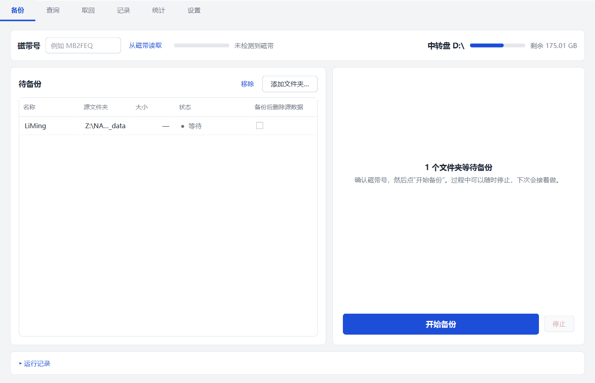
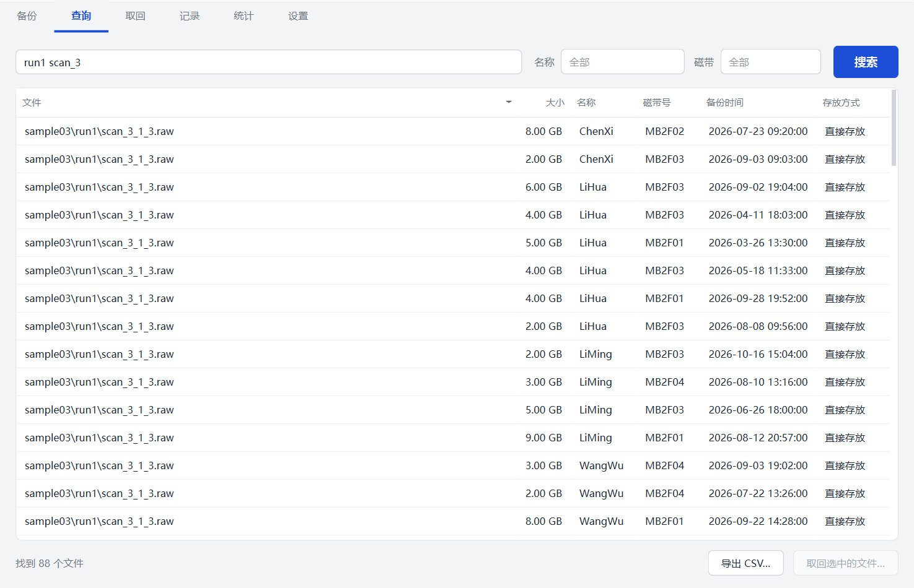
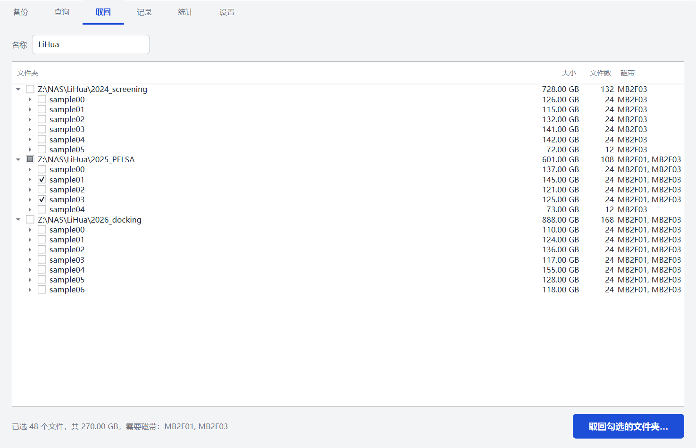
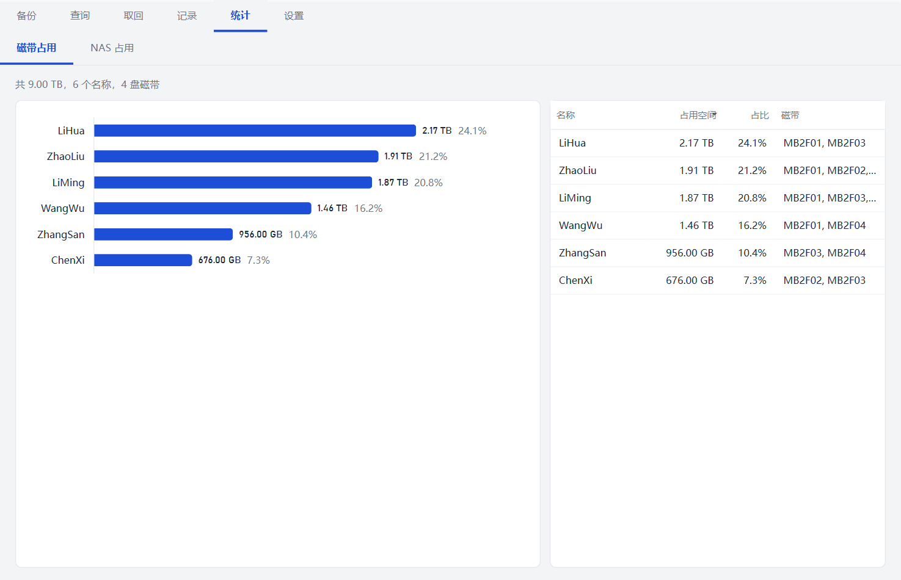
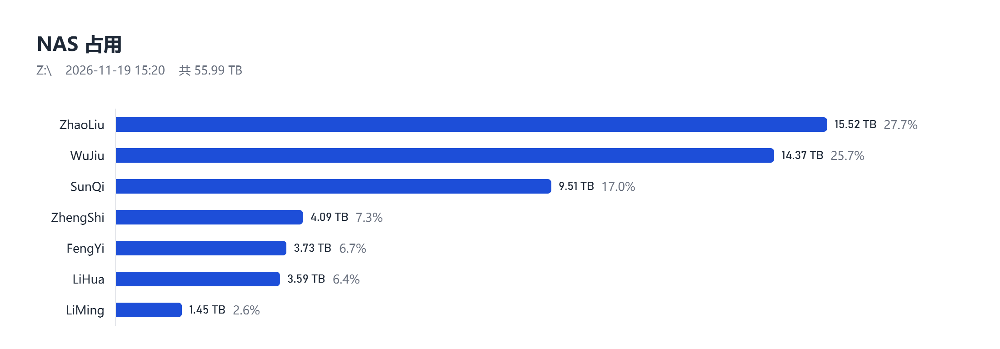
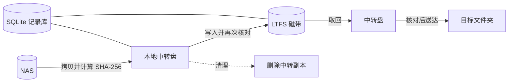

# TapeBackup 磁带备份

把 NAS 上的数据经本地中转盘备份到 LTFS 磁带的 Windows 桌面软件。一键全自动、可随时停止和续跑，每个文件记录在哪盘磁带上，可以按文件名查询、按文件夹取回。



## 功能

- **一键备份**：选择 NAS 上的文件夹排队，自动完成 NAS → 中转盘 → 磁带 → 校验 → 清理，按中转盘和磁带剩余空间动态分批；磁带写满时提示换带，一份数据可以跨多盘磁带。
- **断点续跑**：停电、停止或出错后再点开始，从中断处继续，已完成的文件不重做。
- **增量备份**：同一个文件夹再次备份时，只备份新增或改动过的文件。
- **查询**：边输入边搜索文件名，查到每个文件在哪盘磁带、哪次备份。
- **取回**：按文件勾选，或在文件夹树里勾选整个子文件夹；经中转盘送到指定位置，并核对校验值。
- **统计**：每个人占用的磁带空间；NAS 上每个人的文件夹大小，可导出图片。
- **备份后删除 NAS 源数据**（可选）：确认数据已在磁带上并通过多道检查后才删除。

| 查询 | 取回 |
|---|---|
|  |  |

| 磁带占用 | NAS 占用（导出的图片） |
|---|---|
|  |  |

## 数据安全设计

备份软件最重要的是不丢数据。几条贯穿全程的规则：

- **进度记在数据库里，而且只能比实际慢半拍**：每一步做完、核对通过后才记录"已完成"，所以任何时候中断，重做都是安全的。
- **每个文件都核对 SHA-256**：从 NAS 读取时计算一次，写入磁带时再算一次比对；取回时同样核对。
- **不留半个文件**：先写成 `.part`，完整且核对通过后才改成正式文件名。
- **确认磁带身份**：每盘磁带根目录有一个空的标记文件 `TAPE_ID_<磁带号>.txt`，写入前核对，防止记录指向错误的磁带。
- **删除前多道检查**：只有数据已归档、等过 LTFS 写索引的时间、并在磁带上再次核对后，才会删除 NAS 源文件；只删除与备份记录完全一致的文件，备份后新增或改动的文件会保留，链接文件夹不跟随也不删除。
- **一台磁带机同一时间只做一件事**：备份和取回互斥。

## 工作流程



`.raw` 文件原样存放；其余文件先打成 tar 包再写入磁带，减少磁带上的小文件数量（原样存放的扩展名可在设置里修改）。

## 环境要求

- Windows 10 / 11
- LTFS 磁带机，已挂载为盘符（默认 `F:`）
- 一块本地中转盘（默认 `D:`），空间越大，每批能备份越多
- NAS 已映射为盘符或可通过网络路径访问

## 下载和打包

**直接使用**：在 [Releases](../../releases) 下载 `TapeBackup.exe`，复制到磁带机电脑上双击运行，不需要安装 Python。

**自己打包**（需要 Python 3.13）：

```powershell
git clone <仓库地址>
cd TapeBackup
powershell -ExecutionPolicy Bypass -File build.ps1
```

`build.ps1` 会自动创建虚拟环境 `.venv`、安装 `requirements.txt` 里的依赖，并生成 `dist\TapeBackup.exe`。

开发时也可以不打包直接运行：

```powershell
.venv\Scripts\python run.py
```

## 使用

1. **设置**：首次运行先在"设置"里确认中转盘、磁带盘符和记录存放目录。
2. **备份**：输入磁带号（或点"从磁带读取"），添加要备份的文件夹，点"开始备份"。
3. **查询 / 取回**：在"查询"里搜文件名，或在"取回"里选名称、勾选文件夹，选好目标位置后开始取回，按提示插入对应的磁带。
4. **记录**：查看每次备份的情况，可导出 CSV，也可以导入旧的 `archive_index.csv`。

## 数据存放位置

| 内容 | 位置 |
|---|---|
| 设置 | exe 同目录下的 `config.json` |
| 备份记录库 | `D:\Archive_Index\tape_archive.db`（SQLite） |
| 运行日志 | `D:\Archive_Index\logs\` |
| 上次 NAS 统计结果 | `D:\Archive_Index\nas_usage.json` |

记录库可以在设置里配置自动复制一份到 NAS。

## 测试

```powershell
.venv\Scripts\python -m pytest
```

测试用临时文件夹模拟 NAS、中转盘和磁带，不会读写真实的磁盘和磁带。

## 项目结构

```
tape_backup/
  engine.py          备份流程：扫描、分批、中转、写磁带、核对、清理、断点续跑
  copier.py          边拷贝边计算 SHA-256、tar 打包
  db.py              SQLite 表结构和查询
  restore.py         从磁带取回
  source_cleanup.py  备份后删除 NAS 源数据
  nas_usage.py       统计 NAS 每个文件夹的大小
  config.py          设置读写
  app.py             主窗口
  ui_*.py            各个页面
tests/               自动测试
legacy/              早期的 PowerShell 备份脚本（已被本软件取代）
build.ps1            打包脚本
```

## 许可证

[MIT](LICENSE)
